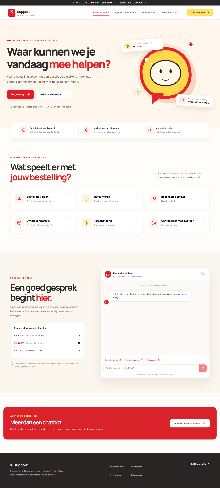

# Rasa Retail Support Agent

[Tests](https://github.com/QinnniQ/rasa-retail-support-agent/actions/workflows/tests.yml) · [AI engineering portfolio](https://profile.nickcloud.dev/) · [LinkedIn](https://www.linkedin.com/in/nicholai-gay-201905148/)

**An independent retail support platform demonstration by [Nicholai Gay](https://profile.nickcloud.dev/).** It shows how a Dutch customer enquiry can become an order lookup, a rule-based answer, and a structured human handoff. Kruidvat is the sole visual showcase brand. The app is **not affiliated with Kruidvat or Rasa** and contains only fictional orders.

The original 2026 prototype contained a Rasa conversation layer, a Python action server, a three-order FastAPI mock, and a Streamlit UI. The React interface, SQLite case workflow, public demo adapter, and engineering explorer are later independent portfolio work. See the [baseline audit](docs/BASELINE_AUDIT.md).



[Mobile homepage screenshot](screenshots/home-mobile.png) · Screenshots captured from automated Chromium browser journeys.

The [English-captioned order walkthrough](assets/walkthrough.gif) illustrates the original order lookup and handoff path. It is an explanation of the prototype, not a recording of a licensed Rasa Pro conversation or a real retailer system. [Open the MP4 version](assets/walkthrough.mp4).

## Try it locally

### Public demo mode — no Rasa license

Prerequisites: Python 3.11 or newer, Node 22+, npm. In PowerShell:

```powershell
python -m pip install -r requirements-dev.txt
$env:SUPPORT_MODE = 'demo'
$env:SUPPORT_OPS_TOKEN = 'choose-a-long-local-secret'
python -m uvicorn mock_backend:app --host 127.0.0.1 --port 8001
```

In another PowerShell terminal:

```powershell
cd frontend
npm ci
npm run dev
```

Open `http://localhost:5173`. Select **Ontbrekend artikel**, then enter `KV-10482`. The order card appears and a simulated case is stored in SQLite. Open **Support Operations** and enter the same `SUPPORT_OPS_TOKEN` to inspect or update the case. The Vite server proxies `/api` to local FastAPI. The database is `data/support.db` by default.

Alternatively, copy `.env.example` to `.env`, set a fresh `SUPPORT_OPS_TOKEN`, and run `docker compose up --build`. Open `http://localhost:8080`. Compose publishes its API only on `127.0.0.1:8001` and persists cases in a named volume. No cloud service is required.

### Genuine Rasa mode — licensed runtime required

The checkout does **not** include Rasa Pro or a license. The pinned `rasa-sdk==3.16.1` dependency resolves for Python 3.11 but does not support this host's Python 3.14, so use Python 3.11 for the action server. With a valid compatible Rasa Pro installation, train the existing `config.yml`, `domain.yml`, and `data/` files using that installation's documented CLI. Start the Rasa server with the REST channel in `credentials.yml` and `endpoints.yml`, plus the action server. For example, with the services running locally:

```powershell
$env:RETAIL_API_URL = 'http://localhost:8001'
$env:SUPPORT_OPS_TOKEN = 'same-secret-as-api'
python -m rasa_sdk --actions actions
```

In a separate licensed Rasa environment:

```powershell
rasa train
rasa run --enable-api --credentials credentials.yml --endpoints endpoints.yml --host 127.0.0.1 --port 5005
```

Set `$env:SUPPORT_MODE = 'rasa'` and `$env:RASA_URL = 'http://localhost:5005'` **before starting the FastAPI process**. The gateway then forwards browser messages to the actual Rasa REST webhook. NLU-triggered flows collect `order_id` for status, missing items, damage, returns, refunds, partner orders, and delivery, then invoke SDK actions using the shared policy code; the explicit human-handoff rule calls the case action. Rasa training and live behavior require verification in the specific licensed version used. The public demo's deterministic router must not be described as Rasa or a trained language model.

For a containerized SDK action server, `docker compose --profile rasa up --build actions`; it connects to the API using `http://api:8001`. A licensed Rasa process on the Windows host can use `endpoints.yml` to reach port 5055. If that process runs inside the Compose network, use `endpoints.docker.yml`. Do not expose Rasa administrative endpoints publicly.

## What to explore

| Example | Scenario | Expected demo behavior |
| --- | --- | --- |
| `KV-10482` | Missing article | Order card and investigation case |
| `KV-20991` | Damaged article | Evidence guidance and review case |
| `KV-77830` | Partner purchase | Partner route and review case |
| `KV-30014` | Delayed order | Status, no automatic case |
| `KV-40025` | Split delivery | Wait for second parcel |
| `KV-50036` | Completed refund | Recorded simulated status |
| `KV-60047` | Return exception | Human review case |
| `KV-70058` | Pending refund | Uncertain status, no promised date |

The customer interface has six guided topics, multi-turn order entry, order cards, quick replies, reset, error messages, and mobile layouts. Support Operations lists cases, filters and searches them, and persists assignment and status changes. The Architecture & System Explorer shows the actual mode, service health, and a trace of observable steps. Its demo trace is explicitly simulated.

## Architecture

```text
Browser (React + TypeScript)
  → FastAPI gateway (/api/chat)
    → demo: deterministic issue routing + shared policy
    → licensed mode: Rasa REST → Rasa SDK actions → retail API
  → fictional order records + SQLite sessions/cases
```

See [architecture and security boundaries](docs/ARCHITECTURE.md), [policy sources](docs/POLICY_AND_SOURCES.md), and [engineering decisions](docs/interview-prep/ENGINEERING_DECISIONS.md). Return eligibility flags are **example rules**, not authoritative Kruidvat or legal advice. No real refund, return, account lookup, representative assignment, or CRM transfer takes place.
The visual direction is documented in the [design reference](docs/DESIGN_REFERENCE.md).

## Verify

```powershell
python -m pytest -q
python -m evaluation.run
cd frontend
npm run format:check
npm run build
npm run test:proxy
npm run test:cloud
npm run test:e2e
npm audit --omit=dev --audit-level=high
```

On 22 October 2026: fourteen API/policy/action/configuration tests passed, fourteen authored demo scenarios passed, four desktop/mobile Chromium tests passed, two Pages proxy tests passed, the TypeScript/Vite build passed, and npm audit found zero known high-severity production dependency vulnerabilities. The scenario suite is small and curated; it does not establish general intent accuracy or business impact. Rasa Pro training, a live Rasa action server, and Docker builds remain unverified in this environment. CI repeats the Python and frontend checks on each push and pull request.

## Deployment boundary

The zero-cost public portfolio uses a Cloudflare Pages Function and D1 for its deterministic demo API. It keeps fictional case records scoped to the visitor's browser session and does not store raw chat text. The Python FastAPI and optional licensed Rasa deployment remain separate: Pages cannot run those Python processes. The Function can alternatively proxy allowlisted `/api` routes to a hosted HTTPS FastAPI `API_ORIGIN`. See the [deployment guide](docs/DEPLOYMENT.md). The public demo must always be described as deterministic demo mode, not as a live Rasa assistant.

## Interview materials

- [Project story](docs/interview-prep/PROJECT_STORY.md)
- [Architecture explained](docs/interview-prep/ARCHITECTURE_EXPLAINED.md)
- [Engineering decisions](docs/interview-prep/ENGINEERING_DECISIONS.md)
- [Technical questions and answers](docs/interview-prep/TECHNICAL_INTERVIEW_QA.md)
- [Five-minute demo script](docs/interview-prep/LIVE_DEMO_SCRIPT.md)
- [Observed failure stories](docs/interview-prep/FAILURE_STORIES.md)
- [CV and portfolio copy](docs/interview-prep/CV_AND_PORTFOLIO_COPY.md)
- [Evaluation methodology and limits](docs/EVALUATION.md)

The original Streamlit implementation remains in `app.py` as historical reference. It is not the default interface and still requires a Rasa server. Contributions from the original collaboration and independent later work should be described separately; details of individual roles require confirmation by the people involved.
