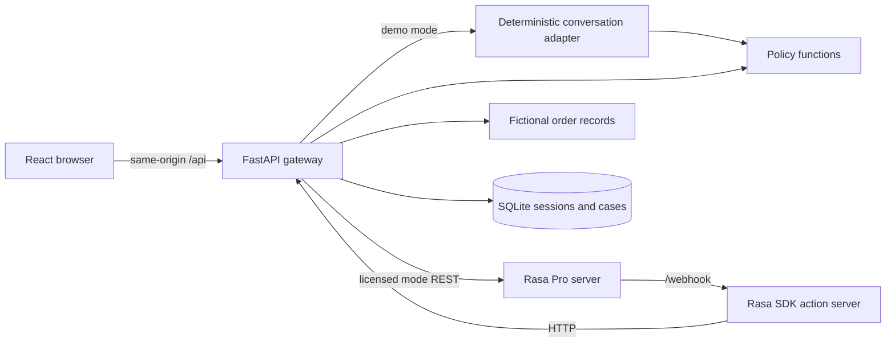

# Architecture and boundaries

The browser sends one message and a random session ID to `/api/chat`. The gateway checks the configured mode. In `demo`, simple Dutch pattern routing preserves issue and order slots in SQLite. It retrieves one of the fictional orders, applies explicit rules, and creates a case for supported exceptions. The response contains text, typed order data, suggested replies, and a labeled simulated trace. In `rasa`, the gateway forwards to the licensed Rasa REST channel using the session ID as sender. Rasa executes its own dialogue and action server; the action calls the retail API. The gateway trace only reports events it can actually observe. It does not fabricate Rasa internals.

The React app is a presentation layer. Case reads and updates require `SUPPORT_OPS_TOKEN`; the UI asks a reviewer to enter it and stores it in session storage for that tab. The token is never bundled into frontend code. This is a local demonstration boundary, **not** a complete production authentication system. A public deployment requires identity, roles, rate limits, session expiry, audit logs, TLS, and a private API network. The sample `/orders` route exposes fictional data only. Nginx proxies `/api` but not `/internal` or `/orders` in the containerized frontend. Rasa administrative APIs must stay private.

SQLite tables are initialized with `CREATE TABLE IF NOT EXISTS` on startup. Schema changes beyond this version would require migrations. The dataset is in source code to keep fixtures transparent; cases and conversation state persist in a Docker volume. A single SQLite file supports this small local demo. A real multi-replica deployment needs a server database and transaction review.
