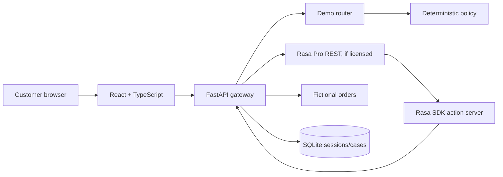

# Architecture explained

| Component | Job and reason | Communication and limitation | Alternative |
| --- | --- | --- | --- |
| React/TypeScript | Presents guided support, order cards, operations, and architecture. Types catch UI contract mistakes. | Calls same-origin `/api`; current state resets if the page reloads. | Server-rendered UI or the original Streamlit prototype. |
| FastAPI | Validates requests, selects demo/Rasa mode, exposes fictional orders and case operations. | HTTP JSON with Pydantic validation; a single local process is the tested target. | Django or another typed API service. |
| Demo router | Provides a public experience without proprietary runtime. | Simple Dutch patterns and SQLite context; misses many natural paraphrases. | A trained intent model after a suitable labeled dataset exists. |
| Rasa Pro | In licensed mode manages intent/flow, slots, and custom action invocation. | REST webhook and action server endpoint; live compatibility not verified here. | Other dialogue orchestrators, but they change the prototype's core demonstration. |
| Rasa SDK actions | Fetch order data and create an explicit demonstration case. | Calls FastAPI over HTTP with timeouts; requires SDK and correct service URLs. | Direct custom-action implementation in another supported runtime. |
| Policy functions | Decide guidance and whether human review is needed. | Pure Python using typed order data; policies are intentionally simplified examples. | A versioned rules engine for a larger policy set. |
| SQLite | Keeps sessions and case lifecycle durable across local restarts. | One file with schema initialization; not designed for multi-region scaling. | Managed PostgreSQL for an authenticated pilot. |

Docker builds images from source; Compose starts and networks containers. The local Nginx frontend proxies `/api` to FastAPI, and the API and action server can address each other by service name. The browser never needs a Rasa administrative URL. The `rasa` mode gateway trace reports only its own REST observation; it does not assert unseen internal steps.
